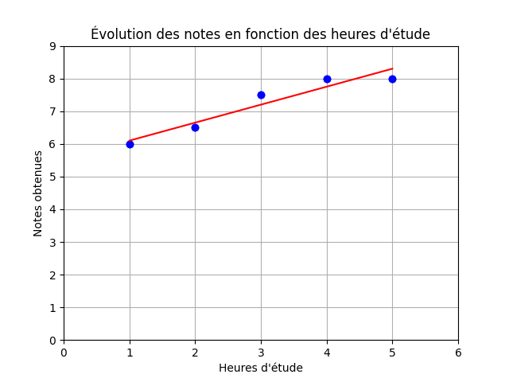
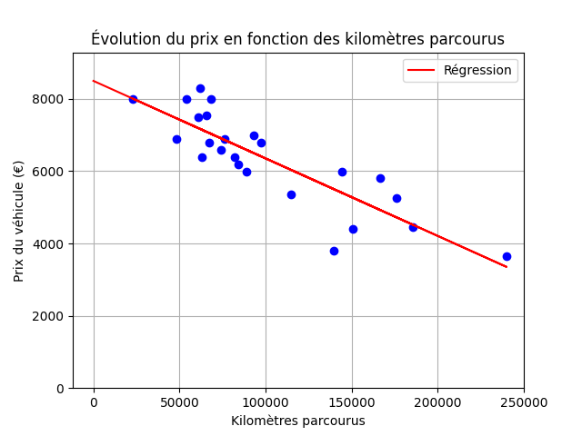
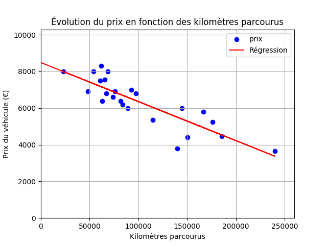

<div align="center">
  <p>
    
    
    
    
    
    
  </p>

  <h1>Linear Regression</h1>

  <p><strong>Régression linéaire simple </strong></p>
  <a href="https://lamizana.github.io/ZehdBox/projets/linear-regression/">
    
  </a>
  <p>Created  on 31/05/2025 · Dernière mise à jour : 16/10/2026</p>
</div>

---

## Sommaire

<details>
<summary>Déplier le sommaire</summary>

- [Sommaire](#sommaire)
- [À propos](#à-propos)
- [Approches](#approches)
- [Comment ça marche](#comment-ça-marche)
- [Installation](#installation)
  - [Prérequis](#prérequis)
  - [Étapes](#étapes)
- [Utilisation](#utilisation)
  - [Partie 1 : Moindres carrés](#partie-1--moindres-carrés)
    - [Notes d'école](#notes-décole)
    - [Prix d'une voiture](#prix-dune-voiture)
  - [Partie 2 : Descente de gradient](#partie-2--descente-de-gradient)
- [Comparaison des deux méthodes](#comparaison-des-deux-méthodes)
- [Structure du projet](#structure-du-projet)
- [Contribuer](#contribuer)
- [Auteur](#auteur)
- [Bibliothèques](#bibliothèques)

</details>

---

## À propos

Introduction au machine learning : mise en œuvre d'une **régression linéaire simple** selon **deux approches différentes**, organisées en deux parties indépendantes :

- Méthode des moindres carrés.
- Méthode descente de gradient.

Le projet couvre la résolution **analytique** (solution fermée) et la résolution **itérative** (descente de gradient), codées de zéro avec NumPy, Pandas et Matplotlib.

| Ressource | Lien |
| --- | --- |
| Fiche du projet (portfolio) | [ZehdBox](https://lamizana.github.io/ZehdBox/projets/linear-regression/) |

---

## Approches

| Approche | Dossier | Méthode | Données |
| --- | --- | --- | --- |
| **Moindres carrés** (OLS) | `method_moindre_carre/` | Formule analytique (solution fermée) | Notes d'école + prix de voiture |
| **Descente de gradient** | `method_descente_gradient/` | Optimisation itérative (10 000 étapes) | Prix de voiture |

---

## Comment ça marche

Le modèle cherche à relier deux variables par une **droite** :

```console
prix = θ₀ + θ₁ × km
```

- `θ₀` : le prix d'une voiture à 0 km (ordonnée à l'origine).
- `θ₁` : la perte de valeur par kilomètre (la pente).

**La fonction de coût** mesure l'écart entre la droite et les données réelles, ici la **MSE** (*Mean Squared Error*), la moyenne des carrés des erreurs.

> [!NOTE]
> Entraîner le modèle, c'est **minimiser la MSE**.

**La descente de gradient** approche ce minimum par itérations :

1. **Normaliser** les données (min-max vers `[0, 1]`) pour stabiliser la convergence.
2. **Itérer** (10 000 fois) : calculer les gradients de la MSE par rapport à `θ₀` et `θ₁`, puis mettre à jour les deux paramètres **simultanément** avec un petit pas (`learning rate = 0,01`).
3. **Dénormaliser** `θ₀` et `θ₁` pour revenir à l'échelle réelle (€, km).

Résultats obtenus sur les 24 voitures du sujet :

- `θ₀ ≈ 8 480,97` (prix à 0 km) · `θ₁ ≈ −0,0213` (perte par km)
- **MAE = 556,48 €**
- **MSE = 445 729,27 €²**
- **R² ≈ 0,733** (≈ 73 % de la variance expliquée)

> [!TIP]
> La méthode des **moindres carrés** (partie 1) obtient le même résultat de façon analytique, sans itération. Pour la version détaillée (théorie, code pas-à-pas, métriques), voir le [tutoriel Régression linéaire](https://lamizana.github.io/ZehdBox/cours/python/linear-regression/).

---

## Installation

### Prérequis

- Python 3.12+
- pip

### Étapes

Cloner le dépôt :

```bash
git clone https://github.com/Lamizana/linear-regression.git
cd linear-regression
```

Installer l'environnement :

```bash
python3 -m venv .venv
source .venv/bin/activate
pip install -r requirements.txt
```

> [!NOTE]
> Les images et `thetas.json` produits à l'exécution (`*.png`) sont ignorés par git ; seules les images du dossier [`assets/`](assets/) (utilisées par ce README) sont versionnées.

---

## Utilisation

### Partie 1 : Moindres carrés

Régression linéaire par **solution analytique** (OLS) : calcul direct de la pente `beta_1` et de l'ordonnée à l'origine `beta_0`. Le détail des formules et des scripts est dans [`method_moindre_carre/README.md`](method_moindre_carre/README.md).

#### Notes d'école

Prédit une note (`/10`) en fonction des heures d'étude. Le nombre d'heures est configurable via la constante `HEURES` en tête de `predict_note.py` (défaut : `2.5` h).

```bash
cd method_moindre_carre/predict_note_ecole
python3 predict_note.py
```



#### Prix d'une voiture

Prédit un prix selon le kilométrage. Le kilométrage est configurable via la constante `KM` en tête de `predict_prix.py` (défaut : `89_000` km).

```bash
cd method_moindre_carre/predict_prix_voiture
python3 predict_prix.py
```



> [!NOTE]
> Chaque script de la partie 1 enregistre un nuage de points et le graphique avec la droite de régression dans son dossier courant.

---

### Partie 2 : Descente de gradient

Régression linéaire par **descente de gradient** sur données normalisées (min-max vers `[0, 1]`), puis dénormalisation des paramètres `theta0` / `theta1`. L'énoncé complet du projet et le détail des scripts sont dans [`method_descente_gradient/README.md`](method_descente_gradient/README.md) et [`method_descente_gradient/enonce.md`](method_descente_gradient/enonce.md).

1. **Entraînement** : lit `data.csv`, ajuste les paramètres, sauvegarde `thetas.json`.

   ```bash
   cd method_descente_gradient
   python3 entrainement.py
   ```

2. **Prédiction** : demande un kilométrage et estime le prix (`theta0 + theta1 * mileage`).

   ```bash
   cd method_descente_gradient
   python3 predict_prix.py
   ```

3. **Bonus** : trace la droite de régression et calcule MSE, MAE et R².

   ```bash
   cd method_descente_gradient
   python3 bonus.py
   ```



---

## Comparaison des deux méthodes

| Aspect | Moindres carrés | Descente de gradient |
| --- | --- | --- |
| ***Résolution*** | Analytique (formule fermée) | Itérative (10 000 étapes) |
| ***Normalisation*** | Aucune | Min-max vers `[0, 1]` |
| ***Persistance des paramètres*** | Aucune (calcul à la volée) | `thetas.json` |
| ***Métriques*** | Aucune (visuel uniquement) | MSE, MAE, R² |
| ***Type de code*** | Script autonome par cas d'usage | Modulaire (entraînement / prédiction / évaluation) |

---

## Structure du projet

```console
linear-regression/
├── assets/                          # Images de ce README
├── requirements.txt
├── method_moindre_carre/            # Partie 1 : moindres carrés (OLS)
│   ├── README.md
│   ├── predict_note_ecole/          # Prédiction de notes selon les heures d'étude
│   └── predict_prix_voiture/        # Prédiction du prix d'une voiture selon le kilométrage
└── method_descente_gradient/         # Partie 2 : descente de gradient
    ├── README.md
    ├── enonce.md                     # Énoncé officiel du projet 42
    ├── entrainement.py               # Entraîne le modèle → thetas.json
    ├── predict_prix.py               # Prédiction interactive du prix
    ├── bonus.py                      # Évaluation (MSE, MAE, R²) + visualisation
    ├── logger.py                     # Logging coloré partagé
    └── utils.py                      # Fonctions partagées (chargement CSV, lecture des thetas)
```

> [!NOTE]
> Les fichiers générés (`*.png`, `thetas.json`) n'apparaissent pas dans cet arbre : ils sont ignorés par git.

---

## Contribuer

Ce dépôt est un projet pédagogique 42 : les corrections et les remarques sont bienvenues via une **issue** ou une **pull request**.

Les messages de commit suivent [Conventional Commits](https://www.conventionalcommits.org/fr/) :

```text
<type>(<scope>): <description>
```

| Type | Usage |
| --- | --- |
| `feat` | Nouvelle fonctionnalité ou nouveau script |
| `fix` | Correction de bug |
| `docs` | Documentation seule |
| `refactor` | Réécriture sans changement de comportement |
| `chore` | Maintenance (configuration, fichiers annexes) |

**Scopes** : `moindre_carre`, `descente_gradient`, `assets`, `readme`, `deps`.

---

## Auteur

**Alex Lamizana** | étudiant à 42 Angoulême, spécialisation Data & IA

- [Site](https://lamizana.github.io/ZehdBox/)
- [GitHub](https://github.com/Lamizana)
- [Contact](https://lamizana.github.io/ZehdBox/contact/)

---

## Bibliothèques

| Libs | Fonctions |
| --- | --- |
| **[NumPy](https://numpy.org/)** | *Calcul numérique et vectorisation* |
| **[Pandas](https://pandas.pydata.org/)** | *Chargement et manipulation des données* |
| **[Matplotlib](https://matplotlib.org/)** | *Visualisation des nuages de points et des droites de régression* |

---

<div align="center">

*Ce projet a été réalisé conformément à la norme et au sujet officiel de 42.*

</div>
